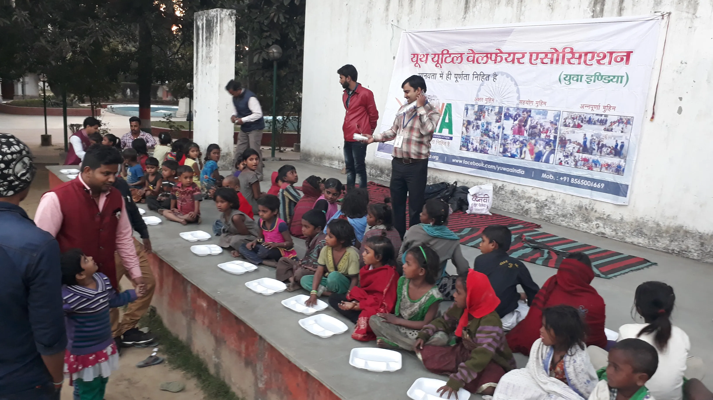
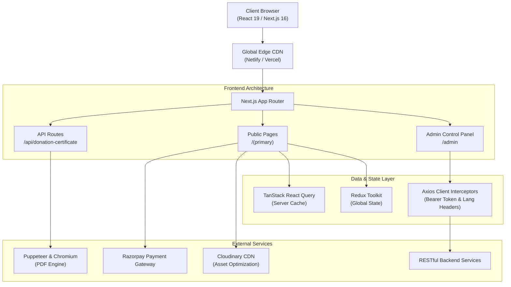

# GiveSphere — Modern Crowdfunding & NGO Impact Platform

<p align="center">
  
</p>

<p align="center">
  <strong>An enterprise-grade, full-stack crowdfunding and NGO fundraising management platform engineered with Next.js 16 (App Router), React 19, TypeScript, Tailwind CSS, and Razorpay.</strong>
</p>

<p align="center">
  
  
  
  
  
  
</p>

---

## Table of Contents
- [Project Overview](#project-overview)
- [Key Features](#key-features)
- [Architecture & Tech Stack](#architecture--tech-stack)
- [Project Directory Structure](#project-directory-structure)
- [Getting Started & Installation](#getting-started--installation)
- [Environment Setup](#environment-setup)
- [Available Scripts](#available-scripts)
- [API Architecture & Integration](#api-architecture--integration)
- [Deployment](#deployment)
- [Contributing & Attribution](#contributing--attribution)
- [License](#license)

---

## Project Overview

**GiveSphere** is a high-performance web platform designed to empower non-governmental organizations (NGOs), non-profits, and charitable institutions. It combines an intuitive public donor experience with a comprehensive administrative control panel for managing fundraising campaigns, tracking online/offline pledges, generating tax exemption certificates, and visualizing donor growth metrics.

### Core Objectives
- **Transparent Giving:** Provide donors with verifiable campaign progress, detailed expenditure breakdowns, and real-time live event donation trackers.
- **Automated Compliance:** Generate instant, pixel-perfect 80G tax exemption donation certificates and receipts rendered server-side with headless Chromium.
- **Administrative Efficiency:** Centralize campaign lifecycle management, donor relations, content authoring (blogs, events, gallery), and notifications in a secure dashboard.
- **Inclusive Accessibility:** Built from the ground up with internationalization (English & Hindi) and responsive design across all viewports.

---

## Key Features

### 1. Donor & Public Portal
- **Campaign Discovery & Support:** Filter and search active causes across education, child welfare, healthcare, women empowerment, disaster relief, and environmental protection.
- **Real-Time Live Event Tracker:** Server-Sent Events (SSE) stream incoming contributions, milestone alerts, and live donor tickers during fundraising drives.
- **Seamless Checkout:** Integration with the Razorpay JS Checkout SDK supporting UPI, credit/debit cards, net banking, and international payments.
- **Offline Donation Pledging:** Acknowledgment workflows for offline pledges, bank transfers, cheques, and cash contributions.
- **Multilingual Support:** One-click language switching between English and Hindi (`i18next` & `next-intl`).
- **Interactive Event Map:** Location discovery using Leaflet and Google Maps API for community service drives and volunteering events.

### 2. Automated 80G Tax Certificate Generator
- **Headless PDF Generation:** Utilizes `@sparticuz/chromium` and `puppeteer-core` in Next.js Server Actions / API routes.
- **Smart Formatting:** Automatic Indian Rupee (INR) number-to-words currency conversion (`numberToWordsINR`), unique serial code generation, and digital signature placement.
- **Instant Download:** One-click receipt download for donors post-payment.

### 3. Comprehensive Administrative Control Center
- **Executive Analytics:** Visual KPI metrics, donor retention curves, and category donation distributions built with Recharts.
- **Campaign Management:** Rich editor for campaign creation, goal targets, photo galleries via Cloudinary, and deadline scheduling.
- **Donation & Donor Ledger:** Paginated data tables with multi-criteria filtering, sorting, status auditing (Success, Pending, Failed, Refunded), and CSV export.
- **Content Management Suite:** Manage team members, corporate partners, blog posts, photo galleries, FAQs, and contact inquiries.
- **Role-Based Route Protection:** Client and server-side middleware guards preventing unauthorized access to `/admin` routes.

---

## Architecture & Tech Stack



| Layer | Technologies |
|---|---|
| **Framework** | [Next.js 16 (App Router)](https://nextjs.org/) with Turbopack bundler |
| **Runtime & Core** | [React 19](https://react.dev/), [React DOM 19](https://react.dev/), [TypeScript 5](https://www.typescriptlang.org/) |
| **Styling & Design** | [Tailwind CSS 4](https://tailwindcss.com/), [PostCSS](https://postcss.org/), [Lucide React](https://lucide.dev/), [React Icons](https://react-icons.github.io/react-icons/) |
| **State Management** | [Redux Toolkit](https://redux-toolkit.js.org/), [React-Redux](https://react-redux.js.org/), [TanStack React Query 5](https://tanstack.com/query) |
| **Forms & Validation** | [React Hook Form](https://react-hook-form.com/), [Formik](https://formik.org/), [Yup](https://github.com/jquense/yup), [Zod 4](https://zod.dev/) |
| **Payment Gateway** | [Razorpay Checkout SDK](https://razorpay.com/docs/payments/payment-gateway/web-integration/standard/) |
| **PDF & Headless Engine** | [Puppeteer Core](https://pptr.dev/), [@sparticuz/chromium](https://github.com/Sparticuz/chromium) |
| **Data Visualization & Maps**| [Recharts 3](https://recharts.org/), [Leaflet](https://leafletjs.com/), [React-Leaflet](https://react-leaflet.js.org/), [@react-google-maps/api](https://www.npmjs.com/package/@react-google-maps/api) |
| **Animations & Sliders** | [Framer Motion](https://www.framer.com/motion/), [GSAP](https://gsap.com/), [Swiper](https://swiperjs.com/), [React Slick](https://react-slick.neostack.com/) |
| **Internationalization** | [next-intl](https://next-intl-docs.vercel.app/), [react-i18next](https://react.i18next.com/), [i18next](https://www.i18next.com/) |

---

## Project Directory Structure

```text
givesphere-platform/
├── .agents/                    # Agentic workflows and PR automation skills
├── public/                     # Static assets, fonts, brand logos, locales
│   ├── assets/                 # Optimized WebP illustrations and photographs
│   ├── fonts/                  # Custom brand WOFF2 typography
│   └── locales/                # Internationalization translation files (en, hi)
├── scripts/                    # Maintenance and operational utility scripts
├── src/
│   ├── animations/             # Reusable Framer Motion animation wrappers
│   ├── app/                    # Next.js App Router (pages, layouts, routes)
│   │   ├── (primary)/          # Route group: Public user pages
│   │   ├── about/              # About Us page
│   │   ├── admin/              # Comprehensive Admin Suite (dashboard, campaigns, donors, etc.)
│   │   ├── api/                # Next.js API Routes (PDF certificate export)
│   │   ├── blog/               # Stories and articles
│   │   ├── campaign/           # Fundraising campaigns with dynamic [id] view
│   │   ├── contact/            # Contact form and office locations
│   │   ├── donate-us/          # Donation gateway with online/offline flows
│   │   ├── events/             # Community activities and outreach
│   │   └── ...                 # Policy pages, team, volunteers, sponsors
│   ├── components/             # Modular React UI components
│   │   ├── Admin/              # Admin dashboard cards, forms, tables, sidebars
│   │   └── Web/                # Public frontend landing sections, sliders, modals
│   ├── contexts/               # React Context providers (Auth, Language)
│   ├── helper/                 # SEO & OpenGraph metadata generators
│   ├── hooks/                  # Custom hooks (API querying, window dimensions, auth)
│   ├── lib/
│   │   └── certificate/        # Server-side HTML & PDF generation pipeline
│   ├── providers/              # Application root providers (QueryClient, Redux)
│   ├── services/               # REST API service abstractions (Admin and Web clients)
│   ├── static-resource/        # Standard navigation items, FAQs, static data
│   ├── store/                  # Redux Toolkit slices and configured root store
│   ├── types/                  # TypeScript interfaces and domain type contracts
│   └── utils/                  # Currency formatting, image dimension standards, cookies
├── .env.example                # Example environment configuration
├── .gitignore                  # Git exclusions for secrets, builds, and node_modules
├── next.config.ts              # Next.js runtime configuration
├── package.json                # Project dependencies and operational scripts
├── postcss.config.mjs          # PostCSS / Tailwind CSS configuration
└── tsconfig.json               # TypeScript strict compiler configuration
```

---

## Getting Started & Installation

### Prerequisites
- **Node.js:** `v20.x` or higher (LTS recommended)
- **Package Manager:** `npm` (v10+), `pnpm` (v9+), or `yarn`
- **Git:** Installed and configured locally

### Installation Steps

1. **Clone the repository:**
   ```bash
   git clone https://github.com/Sonurocks/givesphere-platform.git
   cd givesphere-platform
   ```

2. **Install project dependencies:**
   ```bash
   npm install
   ```

3. **Configure environment variables:**
   ```bash
   cp .env.example .env.local
   ```
   Open `.env.local` and configure your API URL and Razorpay test keys.

4. **Run the local development server:**
   ```bash
   npm run dev
   ```

5. **Open in browser:**
   Navigate to [http://localhost:3000](http://localhost:3000). The admin dashboard is accessible at [http://localhost:3000/admin](http://localhost:3000/admin).

---

## Environment Setup

The application references the following environment variables:

| Variable | Description | Default / Example |
|---|---|---|
| `NEXT_PUBLIC_API_URL` | Base URL for REST API endpoints | `http://localhost:5000/api/v1` |
| `NEXT_PUBLIC_FRONTEND_URL` | Root URL of the frontend deployment | `http://localhost:3000` |
| `NEXT_PUBLIC_RAZORPAY_KEY_ID` | Razorpay Merchant Public Key ID | `rzp_test_your_key_id_here` |

> [!IMPORTANT]
> Never commit `.env` or `.env.local` files containing production secrets to version control. The repository's `.gitignore` is pre-configured to exclude all `.env*` secret files.

---

## Available Scripts

| Command | Description |
|---|---|
| `npm run dev` | Launches the Next.js local development server with Turbopack on port `3000`. |
| `npm run build` | Compiles the production build with type checking and static page generation. |
| `npm run start` | Starts the production server hosting the compiled build. |
| `npm run lint` | Runs ESLint across all TypeScript and React component source files. |

---

## API Architecture & Integration

All HTTP communications are channeled through centralized Axios instances located under `src/services/`:
- **Dynamic Interceptors:** Automatically attaches active JWT Bearer tokens from `js-cookie` to outgoing requests.
- **Language Negotiation:** Injects current `Accept-Language` and `X-Language` headers matching the selected UI locale.
- **Automatic Auth Redirection:** Automatically wipes expired tokens and redirects unauthenticated users on `401` or `403` responses.

---

## Deployment

### Vercel Deployment
1. Connect this repository to your Vercel account.
2. In the project build settings, leave the framework preset as **Next.js**.
3. Add the environment variables specified in `.env.example`.
4. Deploy.

### Netlify Deployment
The repository includes a ready-to-use [`netlify.toml`](./netlify.toml) pre-configured with:
```toml
[build]
  command = "npm run build"
  publish = ".next"
```

---

## Contributing & Attribution

Maintained and developed by **Sonu Gupta** ([@Sonurocks](https://github.com/Sonurocks)).

Contributions, issues, and feature requests are welcome. Feel free to open an issue or submit a pull request following standard Git branching and commit conventions.

---

## License

This project is licensed under the [MIT License](./LICENSE) — see the LICENSE file for details.
